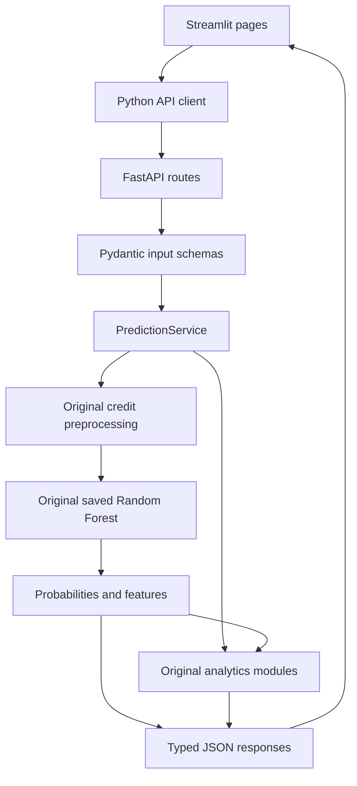

# Architecture and preservation decisions

## Design outcome

The integrated application adopts the professor's separation between an HTTP
application, typed schemas, a service layer, offline ML source, artifacts, tests,
and a frontend API adapter. The actual prediction pipeline is the user's original
credit-default system. The frontend remains Streamlit.

Both source ZIPs were extracted and inspected before the new project was
implemented. Inspection covered every source/configuration/test file, both
projects' notebook cells, model metadata, data inventories, reports, and the
professor's frontend files. The original projects were not edited.

## Ownership of each layer

| Layer | Files | Responsibility |
| --- | --- | --- |
| Application lifecycle | `backend/app/main.py` | App factory, lifespan startup, service instance, error handlers, CORS, compatibility routes |
| HTTP routes | `backend/app/api/routes.py` | Endpoints, multipart uploads, response schemas and service delegation |
| Contracts | `backend/app/schemas/prediction.py` | All 23 raw fields, finite/domain validation and response shapes |
| Serving service | `backend/app/services/prediction_service.py` | Artifact checks, all deployed inference, single/batch/scenarios, explanation/analytics orchestration |
| Original domain code | `backend/src/*.py` | Unchanged feature engineering, preprocessing, scoring, evaluation, SHAP, monitoring, fairness, reporting and optional training research |
| Configuration | `backend/src/config.py`, `backend/config/input_features.json` | Canonical raw-feature order, stable paths, serving limits and optional environment settings |
| Artifacts | `backend/models/` | Unchanged Joblib plus extracted, validated JSON metadata |
| Data | `backend/data/` | Official UCI raw workbook, canonical CSV and explicit restoration provenance |
| Offline work | `backend/notebooks/`, `backend/scripts/` | Portable no-training walkthrough, retained research notebook and explicitly optional diagnostics/research |
| Frontend HTTP boundary | `frontend/services/api.py` | Configurable backend URL, timeouts, request methods and useful errors |
| Frontend presentation | `frontend/app.py`, `pages/`, `components/` | Original Streamlit functionality, forms, charts, files and session state |
| Verification | Backend/frontend tests, `scripts/verify_project.py` | Saved-artifact tests, full-data original-code parity and real HTTP Streamlit integration |

The nine original domain modules and `config/input_features.json` retain their
original bytes. Their internal paths continue to work because their relative
relationships (`src` beside `config` and `models`) are preserved under `backend`.
The application layer owns deployed model loading; the frontend imports neither
backend code nor Joblib/scikit-learn/SHAP.

## Professor patterns adapted

| Professor pattern | Credit-system implementation |
| --- | --- |
| `create_app(artifact_root=...)` | Same injectable factory shape, useful for isolated artifact tests |
| Lifespan-loaded `app.state.service` | One validated credit model per process; no model load on every request |
| `/api` router and separate schemas | Credit-specific endpoints and strict 23-field contract |
| Saved model and metadata validation | Original model checksum, payload, raw/engineered/processed order, classes, hyperparameters and risk rules checked |
| Frontend service adapter | Python HTTPX adapter used by Streamlit |
| Readable model-unavailable state | `/api/health` returns 503; prediction never silently replaces/retrains the model |
| Saved-model tests | Existing RF is exercised; professor's Iris-training fixture is excluded |
| Separate source/data/reports/notebooks | Same organization populated by the credit project and restored UCI data |

The professor's numerical input constraints, class labels, model, datasets,
metrics, notebook logic, JavaScript client implementation, and frontend build
system are not copied. Their domain assumptions do not belong in a credit model.

## Exact inference path

The original artifact contains a dictionary with `pipeline`, `threshold`,
`model_name`, `model_version`, `features`, and `target`. It is not a bare classifier.

1. Validate the customer's original 23 inputs.
2. Call the original `prepare_model_input` function. It selects raw fields,
   converts numeric values, checks finite data and positive credit limit, invokes
   original `add_credit_features`, and selects the exact stored feature order.
3. Preserve original EDUCATION/MARRIAGE mappings and all 15 derived columns.
4. Pass the 38-column frame to the unchanged fitted pipeline. Its StandardScaler
   handles 35 numeric fields. Its fitted OneHotEncoder handles three categorical
   inputs and outputs six encoded fields, yielding 41 classifier columns.
5. Read `predict_proba(... )[:, 1]` for default probability and compare with the
   stored threshold using `>=`.
6. Return original binary classification and both original risk-band systems.

The deployed forest has 400 trees, maximum depth 10, minimum leaf size 7,
minimum split size 3, balanced-subsample class weights, and random state 42. These
are extracted facts from the supplied model, not a new training configuration.
The original model SHA-256 is recorded in metadata and tests. It was neither
fitted nor serialized again.

All serving paths converge on the service's shared inference code. Scenario
analysis varies only the six payment amounts by the original factors 0, 0.5, 1,
1.5 and 2. A factor of 1 preserves the ordinary prediction. Batch scoring and
analytics use the same fitted pipeline and feature order.

## Validation and errors

- Strict JSON rejects missing or extra fields, numeric strings, booleans,
  nonfinite values, unsupported categories, fractional integer fields, and
  original-domain violations.
- CSV accepts numeric text, validates each row centrally, preserves text IDs and
  extra fields, and rejects duplicate headers or malformed records.
- Blank lines and quoted multiline fields retain the real source record-start
  line in result/error `row_number` values.
- Strict batch mode scores nothing if any row is invalid. Explicit skip mode
  returns accepted results and reasons for rejected rows. An entirely invalid
  file returns 422.
- Output-name collisions preserve the user's original column under a unique
  `input__...` name; the response describes the renaming.
- Invalid customer input returns 422, oversized file upload 413, unavailable
  model 503, and unexpected server failure a generic 500. Logs contain the
  diagnostic exception; responses do not expose traceback internals.
- Both API input and public probability-service entry points validate the
  customer domain. Extreme finite inputs that overflow feature/model ranges are
  rejected cleanly.

The 20 MiB/50,000-row CSV limits are transport controls. They do not alter valid
credit feature calculations or model parameters. Application requests do not
persist uploaded customer data to disk.

## Frontend preservation

The active Violet Aurora style, history editor, demo/reset controls, insights,
gauge and payment charts were adapted into shared presentation helpers. Local
model loading, feature construction for inference, SHAP computation, and direct
prediction calls were removed from Streamlit and replaced with HTTP requests.
Presentation-only ratios, units, plotting and formatting remain appropriate
frontend responsibilities; the source engineered indicators come from the API.

The two original batch views had different validation behavior. Their useful
features are combined in one view with an explicit strict/skip choice and
identifier preservation. Model information from an older backup is now a page.
Existing backend monitoring, fairness and reporting modules are exposed through
an analytics page rather than being left as unused CLI-only functionality.

The original UI band (`Low/Moderate/High`) and risk-score band
(`Low/Medium/High`) are shown separately. Metadata is validated against both rules
to prevent documentation from silently contradicting predictions. The age audit
uses the original notebook's right-closed boundaries at 30, 40, 50 and 60.

Scenario ranking uses full-precision probability. Changing uploads or audit
settings clears stale report results. CSV previews preserve leading-zero IDs.
Backend outages produce an actionable message instead of a local fallback score.

## Data, metadata, and historical results

The credit ZIP had no data file or standalone metadata JSON. The final package
therefore includes official UCI data with source/license/checksums and a new
metadata JSON extracted from the original model. This restores the documented
dataset, but cannot prove byte identity with the absent user's local CSV.

The supplied historical report is retained unchanged and also embedded in model
metadata so its display is independent of the reports directory. Its metrics are
explicitly marked as historical and not newly verified. No training date, ROC
curve, confusion matrix, fairness result, or model performance is invented.
New analytics reports compute metrics only from supplied observed labels and
state which uploaded records they describe.

The original historical notebook is preserved unchanged and clearly separated
from the new portable inference notebook. Its historical Colab/training cells
were not run. Six stale HGB-candidate scripts are excluded because their candidate
artifacts are missing and their exploratory threshold is not the deployed RF's
threshold. Original portable analytics and optional future research remain.

## Verification and scope

The default tests never fit a model. They compare integrated predictions and all
38 engineered values against a frozen baseline generated with the pristine
original source/model for all 30,000 restored UCI rows. This establishes software
behavioral parity on that input set; it is not a new generalization-performance
study.

Frontend testing combines isolated presentation/client tests and a real Uvicorn
process. Streamlit AppTest runs the actual pages and saved-model workflows. It
does not operate a native browser file picker; upload objects are supplied at
that UI boundary while their multipart requests and backend execution remain
real. No deployment to a public server or live MLflow registry was performed.

See [TEST_RESULTS.md](TEST_RESULTS.md) for executed results and qualifications.
